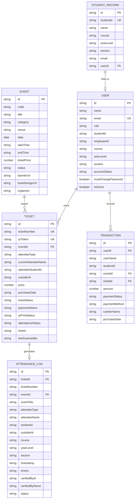
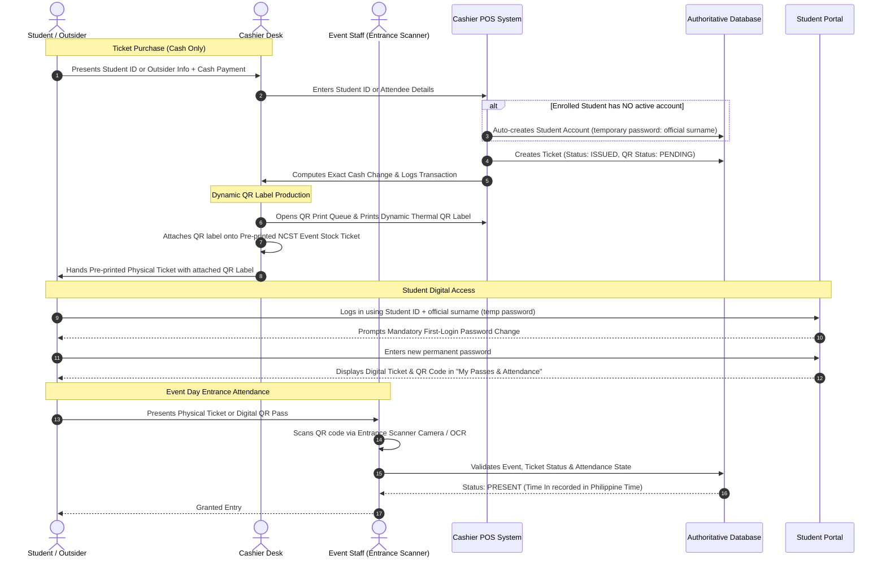

# NCST Events & Tickets System — System Architecture & Technical Specification

> **Authoritative System Architecture & Functional Specification**  
> Educational Campus Event Management, POS Ticketing, Dynamic QR Serialization, and Real-Time Entrance Attendance Tracking.

---

## 1. System Overview & Technology Stack

The **NCST Events & Tickets System** is a unified digital event management, ticketing point-of-sale (POS), and entrance attendance tracking platform. It coordinates administrators, cashiers, event staff, faculty teachers, and students through role-based access control (RBAC), optical QR validation, and automated student onboarding.

### Technology Stack
* **Frontend Framework**: [Vue 3](https://vuejs.org/) (`<script setup lang="ts">`) + [TypeScript](https://www.typescriptlang.org/)
* **State Management**: Reactive centralized store ([`src/composables/useAppStore.ts`](file:///d:/Downloads/Integ%202/src/composables/useAppStore.ts)) with LocalStorage persistence and RESTful server synchronization
* **Styling & UI**: [Tailwind CSS v4](https://tailwindcss.com/) with dark/light mode and responsive layout
* **Iconography & Visuals**: `lucide-vue-next` / `@lucide/vue` & `canvas-confetti`
* **Scanning & Vision**: `html5-qrcode` (Optical camera QR scanner) + `tesseract.js` (OCR text scanning fallback)
* **Barcoding & Export**: `qrcode` (Dynamic 2D sticker generation) & `xlsx` (Excel attendance data export)
* **Backend & API Layer**:
  - **Dev Server Middleware**: In-memory authoritative RBAC API & session mocking ([`vite.config.ts`](file:///d:/Downloads/Integ%202/vite.config.ts))
  - **Production Backend**: RESTful PHP scripts ([`api/*.php`](file:///d:/Downloads/Integ%202/api/)) + MySQL / MariaDB relational database ([`database.sql`](file:///d:/Downloads/Integ%202/database.sql))

---

## 2. Core Entities & Data Architecture



### Entity Specifications

#### 1. Event Entity (`EventItem`)
* **Identifiers & Info**: Unique `id`, event `code`, `title`, `description`, `category` (e.g. Academic, Cultural, Sports, Concert), `organizer`.
* **Schedule & Location**: Event `date`, `startTime`, `endTime`, `venue`.
* **Ticketing & Media**: `ticketPrice` (PHP cash amount; 0 for free), `status` (`upcoming`, `ongoing`, `completed`, `cancelled`), `bannerUrl`, `ticketDesignUrl`.
* *(Note: NCST events do not use event capacity or quota restrictions).*

#### 2. Student Record (`StudentRecord`)
* Authoritative institutional roster record from the registrar/dean master list, distinct from user login accounts.
* Fields: `id`, `studentId`, `name`, `course`, `yearLevel`, `section`, `department`, `email`, `userId` (linked account pointer).
* Section format strictly adheres to NCST format: `[Year][Semester][Schedule][Section]` (e.g. `11M1`, `21M2`, `31M1`, `41M3`).

#### 3. User Entity (`User`)
* Roles: `admin` | `cashier` | `teacher` | `event_staff` | `student`.
* Fields: `id`, `name`, `email`, `password`, `studentId` / `employeeId`, academic affiliations (`course`, `yearLevel`, `section`), `assignedClasses` (for teachers), `accountStatus` (`active`, `pending_activation`, `deactivated`), `mustChangePassword`, `isActive`.

#### 4. Ticket Entity (`Ticket`)
* **Control & Credentials**: `id`, `ticketNumber` / Control Number, secure `qrToken`.
* **Classification**: `attendeeType` (`STUDENT` | `OUTSIDER`).
* **Owner & Identity**: `currentAttendeeName`, `attendeeStudentId`, `outsiderId`, `course`, `yearLevel`, `section`, `contactNumber`.
* **Pricing & Lifecycle**: `price`, `purchaseDate`, `ticketStatus` (`ISSUED`, `USED`, `VOID`), `paymentStatus` (`paid`, `free`).
* **Dynamic QR Production**: `qrPrintStatus` (`PENDING`, `PRINTED`, `ATTACHED`), `qrPrintedAt`, `qrPrintCount`.
* **Attendance State**: `attendanceStatus` (`not_entered` / NOT YET ENTERED, `present` / PRESENT), `timeIn` (PHT UTC+8), `lastScannedBy`.
* *(Note: NCST tickets are strictly non-transferable).*

#### 5. Attendance Entity (`AttendanceLog`)
* Real-time entrance log records capturing: `id`, `ticketId`, `ticketNumber`, `eventId`, `eventTitle`, `attendeeType`, `attendeeName`, `studentId`, `outsiderId`, `course`, `yearLevel`, `section`, `timeIn` (PHT), `timestamp` (ISO), `verifiedById`, `verifiedByName` (Event Staff identifier), `status` (`valid` | `denied`).

#### 6. Transaction Entity (`PurchaseTransaction`)
* Sales record created at the Cashier POS: `id`, `userId`, `userName`, `studentId`, `eventId`, `eventTitle`, `ticketId`, `ticketNumber`, `amount`, `paymentStatus`, `paymentMethod` (Cash only), `cashierName`, `purchaseDate`.

---

## 3. Physical & Digital Ticketing Workflows



### Pre-Printed Physical Ticket Stock & Dynamic QR Workflow
1. **Pre-Printed NCST Event Stock**: Standard pre-printed physical ticket stock containing official NCST branding, event artwork, terms, and a blank designated rectangular area for the dynamic QR sticker.
2. **Cashier Point of Sale (POS)**:
   - Cashier verifies attendee information (Student ID or Outsider name/contact) and selects the event.
   - Official event pricing is applied; payment is processed via **Cash-only** handling with exact change calculation.
   - The system generates an authoritative Control Number and cryptographically unique `qrToken`.
3. **Dynamic QR Label Print Queue**:
   - The QR label is queued in the Cashier's **QR Print Queue** ([`src/components/cashier/QRPrintQueue.vue`](file:///d:/Downloads/Integ%202/src/components/cashier/QRPrintQueue.vue)).
   - Printed separately on thermal adhesive label stock.
   - The cashier affixes the printed QR label onto the designated QR box on the physical ticket before handing it to the attendee.
4. **Entrance Attendance Scanning**:
   - Event Staff scans the QR label at the Entrance Scanner to log attendance.

---

## 4. Student Account Lifecycle & Onboarding

### Automated Account Creation Flow
When an unregistered enrolled student purchases an event ticket at the Cashier POS:
1. **Roster Match**: The system matches the provided Student ID with the authoritative student roster ([`StudentRecord`](file:///d:/Downloads/INTEG/src/types/index.ts)).
2. **Automatic Provisioning**: A student login account is automatically created without printing any paper slips or activation codes.
3. **Initial Temporary Password**: The account is assigned the student's official surname as an initial temporary password (hashed securely with PHP bcrypt; `mustChangePassword: true`).
4. **First-Time Sign In**: The student visits the web portal and enters their Student ID and official surname as temporary password.
5. **First-Login Password Change**: The portal and backend APIs block access to digital tickets and logs until the student sets a permanent custom password (cannot be their surname, `ncst123`, or `password123`).
6. **Instant Pass Availability**: The purchased event pass automatically appears under **My Passes & Attendance** with its digital QR code and live attendance status.

> [!WARNING]
> **Security Limitation of Surname-Based Temporary Passwords**  
> Using official surnames as temporary passwords is a project-specific convenience to streamline in-person cashier onboarding without slowing ticket issuance or generating paper credential slips. Surnames and Student IDs are not confidential secrets. Therefore, surname-based authentication is **not immune to peer impersonation** prior to initial account claim. To mitigate this risk, the backend strictly requires immediate password change before granting access to student data or tickets, rejects weak generic passwords, strictly preserves existing passwords on subsequent ticket purchases, and logs all credential changes.

### Student Self-Registration Flow (Authoritative StudentRecord Lookup)
For enrolled students registering their portal account before or outside ticket purchases:
1. **Student ID as Lookup Key**: The Student ID acts as an authoritative lookup key that automatically retrieves the student's existing NCST `StudentRecord`, eliminating duplicate manual data entry.
2. **Progressive Disclosure**:
   - **Step 1 (ID Lookup)**: Student enters their official Student ID (e.g. `2024-58566`). The system queries `lookupStudentRecord()` and displays the matching record (Name, Course, Year Level, Section, Department) with an "Is this you?" confirmation prompt.
   - **Step 2 (Account Setup)**: Upon confirming identity, the student completes institutional email OTP verification and sets their permanent password.
3. **Strict Authoritative Binding**: The backend derives all academic fields directly from `StudentRecord` and binds the newly created user login account to the enrollment identity.

---

## 5. Role-Based Access Control (RBAC) Specification

| Role | Permitted Workspace Modules & Capabilities | Restricted Actions |
| :--- | :--- | :--- |
| **🛡️ Administrator** (`admin`) | • Executive Dashboard & Analytics<br>• Event Management (create, edit, schedule, archive)<br>• Real-Time Active Attendance & Historical Archive<br>• Master Ticket Registry (search, filter, void)<br>• User Management (provision staff, reset passwords)<br>• Attendance Reports & Master Excel Export<br>• Events Calendar | None. |
| **🎟️ Cashier** (`cashier`) | • Ticket POS Station (Student & Outsider ticket issuance)<br>• Cash payment handling & change calculation<br>• Dynamic QR Label Print Queue & reprint<br>• Automatic Student account onboarding (official surname)<br>• Issued Tickets Registry (read-only verification)<br>• Events Calendar | ❌ Cannot create/edit events<br>❌ Cannot scan or modify attendance<br>❌ Cannot manage user accounts/roles<br>❌ Cannot create Outsider login accounts |
| **👨‍🏫 Teacher** (`teacher`) | • Faculty Attendance Portal (scoped strictly to explicit `assignedClasses` Course + Section pairs)<br>• Active Class Scope selector (`[ BSIT — 11M1 ▾ ]`)<br>• Attendance monitoring (PRESENT / NOT YET ENTERED / Time In)<br>• Alphabetical sorting strictly by Student Last Name (A–Z)<br>• Scoped Attendance Reports & Excel Export<br>• Events Calendar | ❌ Cannot scan QR codes<br>❌ Cannot issue or void tickets<br>❌ Cannot process payments<br>❌ Cannot create/edit events<br>❌ Cannot modify master roster<br>❌ Cannot manage academic incentives or grade sheet calculations |
| **📱 Event Staff** (`event_staff`) | • Entrance Scanner Station<br>• Optical Camera QR scanning & recovery lookup<br>• Attendance validation & Time-In recording (PHT)<br>• Duplicate scan detection & alert banner<br>• Events Calendar | ❌ Cannot access ticket sales or POS<br>❌ Cannot edit events or manage users<br>❌ Cannot export financial or roster data |
| **🎓 Student** (`student`) | • Campus Events Calendar (event dates, venue, details)<br>• My Passes & Attendance (view digital QR passes, view Time-In)<br>• Upcoming Event Reminders<br>• Account Profile & First-Login Password Change | ❌ Cannot view other students' passes or logs<br>❌ Cannot issue or transfer tickets<br>❌ Cannot pay through the portal (Cashier POS only)<br>❌ Cannot access administrative or scanning tools |

---

## 6. Attendance Validation & Entrance State Machine

Attendance is strictly **ENTRY-ONLY** and follows a 2-state progression:

```
[ NOT YET ENTERED ]  ──( Valid Scan by Event Staff )──>  [ PRESENT + Time In (PHT) ]
```

### Scan Validation Rules
1. **Event Association**: The scanned ticket must belong to the active event assigned to the Event Staff.
2. **Ticket Status**:
   - `ISSUED`: Valid for entry. Upon scan, ticket status updates to `USED`, attendance status updates to `PRESENT`, and `timeIn` is recorded in Philippine Standard Time (PHT, UTC+8).
   - `USED`: Ticket was already scanned. The scanner displays an immediate **⚠️ ALREADY USED** duplicate entry warning.
   - `VOID`: The scanner rejects entry and displays an invalid ticket alert.
3. **Scan Result Information**: The scanner displays concise attendee identity information:
   - Attendee Name
   - Classification (`STUDENT` / `OUTSIDER`)
   - Student ID (for students)
   - Ticket / Control Number
   - Event Title
   - Time In (Philippine Standard Time)

---

## 7. Standard System Terminology

To maintain consistency across code, tests, and documentation, the following terminology is standardized:

| Concept | Standard Term | Deprecated / Disallowed Terms |
| :--- | :--- | :--- |
| Gate Personnel | **Event Staff** | Gatekeeper, Bouncer, Guard |
| Scanning Station | **Entrance Scanner** | Gate Scanner, Gate 1 / Gate 2, Gate Area |
| Pre-Entry Attendance Status | **NOT YET ENTERED** | NOT YET SCANNED, Unscanned, Absent |
| Verified Entry Attendance Status | **PRESENT** | Entered, Checked In |
| Active Ticket Status | **ISSUED** | ACTIVE, UNUSED |
| Scanned Ticket Status | **USED** | CONSUMED, CHECKED_IN |
| Revoked Ticket Status | **VOID** | CANCELLED, REFUNDED |
| Initial Student Password | **Official Surname** | `ncst123`, random password, Activation Code |
| Account Setup Process | **First-Login Password Change** | Account Activation Slip, Activation Code |
| Faculty Scope | **Explicit Assigned Classes (`(Course, Section)`)** | Independent assignedCourses / assignedSections arrays |
| Section Code Convention | **`[Year][Sem][Sched][Sec]` (e.g. `11M1`, `31M1`)** | Arbitrary text, Section A |

---

## 8. Security Architecture & Credential Hardening

The system implements zero plain-text credential persistence and strict API perimeter defenses:

* **Cryptographic Password Hashing**: Passwords are saved exclusively as one-way Bcrypt hashes (`PASSWORD_BCRYPT` with cost factor 10). Legacy passwords automatically upgrade on first authentication.
* **Stateless HMAC Authentication Tokens**:
  * Authenticated sessions issue an authoritative, digitally signed `NCST_AUTH_TOKEN` (`HMAC-SHA256`).
  * Tokens encapsulate user identity, role, and a 24-hour expiration timestamp.
  * Verified statelessly in [`api/auth_helper.php`](api/auth_helper.php) on every request without session locks.
* **Environment Variable Isolation**:
  * Database credentials, encryption secrets (`APP_KEY`, `SESSION_SECRET`), and CORS origins are strictly isolated in [`.env`](.env) (template provided in [`.env.example`](.env.example)).
  * Protected against web exposure via Apache directory access rules.
* **Brute-Force Rate Limiting**:
  * Enforces IP-based sliding window rate limiting (maximum 5 failed authentication attempts per minute).
* **Apache Authorization Header Preservation**:
  * Standard Apache installations strip `Authorization: Bearer` headers by default. Mitigated via rewrite directives in [`api/.htaccess`](api/.htaccess):
    ```apache
    RewriteRule .* - [E=HTTP_AUTHORIZATION:%{HTTP:Authorization}]
    ```

---

## 9. Modular Frontend Composables Architecture

The frontend state and domain logic are organized into specialized, reusable Vue 3 composables under `src/composables/`, all accessible through the centralized index ([`src/composables/index.ts`](src/composables/index.ts)):

| Composable | Responsibility & Key Methods |
| :--- | :--- |
| **`useAuth`** | Session state, token parsing, login/logout, role checks (`isAdmin`, `isCashier`, `isStaff`, `isTeacher`, `isStudent`), password changes. |
| **`useEvents`** | Event lifecycle, event creation, search, filter by category/status, active event selection. |
| **`useTickets`** | Ticket issuance, POS cart validation, QR token generation, voiding, filtering by event/attendee. |
| **`useScanner`** | Optical camera controls, torch toggle, haptic vibration feedback, audio synthesizer chimes, ticket entry validation, offline queue. |
| **`useStudentRoster`** | Registrar student master records, section parsing, auto-account creation hooks, teacher class assignments. |
| **`useToast`** | Global reactive notifications (`success`, `error`, `warning`, `info`) with auto-dismissal. |
| **`useAppStore`** | Central orchestrator integrating all domain hooks, local persistence, and background delta synchronization. |

---

## 10. Mobile Scanner Station UX & Offline Resilience

Designed specifically for handheld mobile devices used by Event Staff at entrance gates:

* **Haptic Vibration Feedback**: Leverages `navigator.vibrate` to deliver physical tactile confirmation:
  * Single 180ms pulse on valid entry.
  * Double 100ms pulse pattern on already used or invalid tickets.
* **Synthesized Audio Chimes**: Web Audio API generates immediate auditory cues without external audio asset downloads:
  * High-frequency ascending chime (880 Hz → 1320 Hz) for `PRESENT`.
  * Low-frequency descending buzz (300 Hz → 180 Hz) for invalid scans.
* **Camera Torch / Flashlight Control**: Direct hardware torch toggling via MediaStream track constraints for low-light campus venues.
* **Continuous Rapid Scanning**: Stream stays active for back-to-back scanning with automated duplicate debounce windows.
* **Manual ID Fallback**: Seamless keyboard overlay for entering Student IDs or Control Numbers when physical tickets have damaged QR codes.
* **Offline Local Queue**: Scans made while disconnected are queued locally and automatically synced once network connectivity returns.

---

## 11. High-Performance Real-Time Delta Sync Engine

To replace heavy periodic full-state polling, the system features a delta synchronization protocol:

* **Server Endpoint**: `GET /api/state?since=<TIMESTAMP>`
  * Returns only records modified since the client's last known synchronization timestamp.
  * Reduces network bandwidth by **>98%** compared to full snapshot transfers.
  * Optimized with in-memory modification caches and sub-2ms MySQL queries.
* **Adaptive Polling Schedule**:
  * **Active Tab**: Polls every 5 seconds.
  * **Background / Minimized Tab**: Scales back to 30 seconds to conserve battery and server bandwidth.
  * **Foreground Wake**: Immediately triggers a sync cycle when the user switches back to the application.
* **Debounced State Pushes**: Client updates are debounced (400ms) to bundle rapid sequential operations into atomic requests.

---

## 12. Testing, Reliability & Error Handling

### Automated Master Test Suite
Run the full frontend and backend regression suite with a single command:
```bash
npm test
```
* **Frontend Logic (19 Suites)**: Discovers and runs all automated suites in [`scripts/run-all-tests.mjs`](scripts/run-all-tests.mjs).
* **Backend Integration (2 Suites)**: Validates authentication, password security, and delta sync via [`scripts/run-all-tests.php`](scripts/run-all-tests.php).

### Application-Level Error Boundary
* Configured in [`src/App.vue`](src/App.vue) via `onErrorCaptured`.
* Catches unhandled runtime exceptions in any view, replacing blank white screens with an interactive recovery card offering retry and home-navigation options.

### Real-Time Connectivity Banner
* Automatically detects offline state and displays a top status banner informing staff that scans are protected locally.

---

## 13. Documentation & Operational References

* 📱 **[Mobile Testing & Camera Guide](docs/MOBILE_TESTING_GUIDE.md)**: Network firewall setup, mobile browser HTTPS requirements, and camera permissions walkthrough.
* 🏭 **[Production Deployment Checklist](docs/PRODUCTION_DEPLOYMENT.md)**: Web server (Apache/Nginx), PHP extensions, MySQL permissions, environment secrets, and automated daily backup routines.
* 📚 **[Obsidian Architecture Knowledge Base](docs/obsidian/00%20-%20Map%20of%20Content%20(Index).md)**: Interlinked Markdown documentation covering data models, workflows, RBAC, and schemas.

