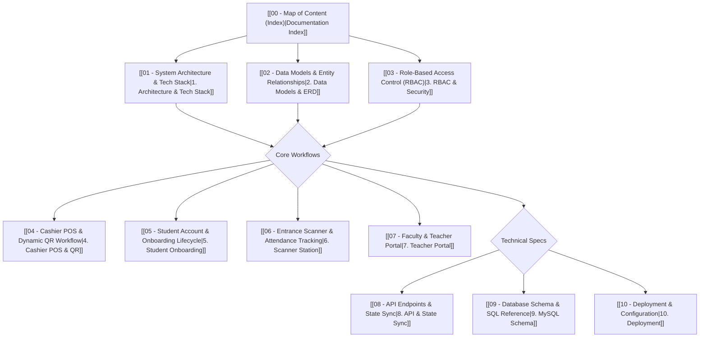

# 🎓 NCST Events & Tickets System — Documentation MOC

> [!ABSTRACT] Executive Summary
> Authoritative system documentation for the **NCST Events & Tickets Management Platform**. This system coordinates event management, Cashier Point-of-Sale (POS) ticketing, dynamic thermal QR sticker serialization, real-time entrance attendance tracking, and role-based student and faculty portals.

---

## 📚 Table of Contents

### 1. Architectural Foundations
* [[01 - System Architecture & Tech Stack]] — Stack languages (TypeScript, PHP, SQL, JS), Vue 3, Tailwind CSS, API middleware, and hybrid architecture.
* [[02 - Data Models & Entity Relationships]] — Entity relationship diagram (ERD), TypeScript models, and lifecycle status enums.
* [[03 - Role-Based Access Control (RBAC)]] — Matrix of permissions for Admin, Cashier, Staff, Teacher, and Student.

### 2. Operational Workflows
* [[04 - Cashier POS & Dynamic QR Workflow]] — Cash ticketing, exact change calculation, thermal QR sticker printing, and physical ticket stock assembly.
* [[05 - Student Account & Onboarding Lifecycle]] — Automatic account creation (`ncst123`), authoritative student roster matching, and self-registration.
* [[06 - Entrance Scanner & Attendance Tracking]] — Optical camera QR reader, duplicate scan detection, and Philippine Standard Time (PHT) attendance logging.
* [[07 - Faculty & Teacher Portal]] — Section-scoped attendance filtering (e.g., `BSIT — 11M1`), A–Z alphabetical roster sorting, and Excel exports.

### 3. Backend, Data & Operations
* [[08 - API Endpoints & State Sync]] — REST API endpoints, session verification headers, and bidirectional state synchronization.
* [[09 - Database Schema & SQL Reference]] — MySQL table schemas, indexes, foreign keys, and SQL seed data.
* [[10 - Deployment & Configuration]] — Dev server setup, production build, XAMPP Apache configuration, and environment flags.

---

## 🏷️ System Tags
#ncst #ticketing #vue3 #typescript #tailwind #rbac #qr-code #attendance #pos #mysql #obsidian
