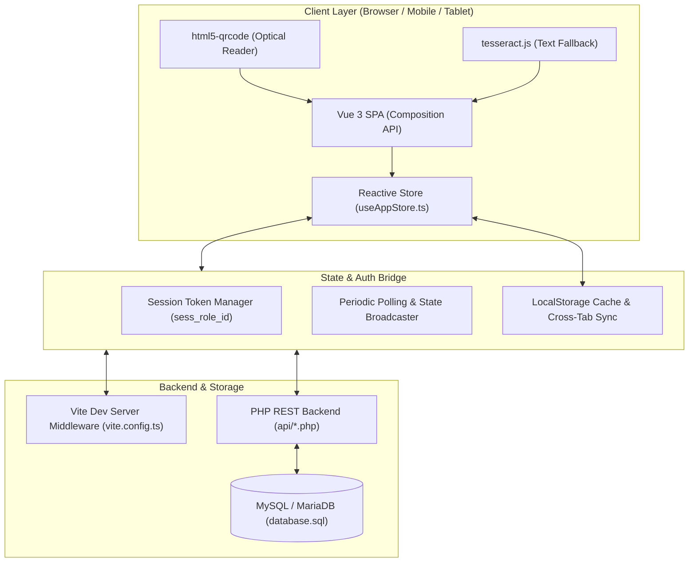

# 🏗️ System Architecture & Technology Stack

> [!INFO] Navigation
> Back to [[00 - Map of Content (Index)]] | Next: [[02 - Data Models & Entity Relationships]]

---

## 1. High-Level Architecture

The **NCST Events & Tickets System** is built on a hybrid architecture: a reactive Vue 3 Single-Page Application (SPA) on the frontend, an in-memory API middleware for rapid development, and a RESTful PHP/MySQL backend for production deployment.



---

## 2. Programming & Stack Languages

The system leverages five distinct languages across its layers:

```
+---------------------------------------------------------------------------------------+
| LAYER                | LANGUAGE          | FILE EXTENSIONS | PRIMARY USAGE            |
+----------------------+-------------------+-----------------+--------------------------+
| Frontend UI & Logic  | TypeScript        | .ts, .vue       | Store, Models, Views     |
| Test Automation      | JavaScript (ESM)  | .js, .mjs       | Test Suites & CLI Scripts|
| Production Backend   | PHP (8.1+)        | .php            | REST API & PDO Queries   |
| Relational Storage   | SQL               | .sql            | MySQL Schema & Indexes   |
| Presentation & Theme | HTML5 / CSS3      | .html, .css     | Markup & Tailwind v4     |
+----------------------+-------------------+-----------------+--------------------------+
```

### 1. **[TypeScript](https://www.typescriptlang.org/) (`.ts` / `.vue`)**
* **Role**: Primary language for the entire frontend application and development server middleware.
* **Usage**:
  - Centralized reactive store ([`src/composables/useAppStore.ts`](file:///c:/xampp/htdocs/Integ%202/src/composables/useAppStore.ts)).
  - Strongly typed data models and entity interfaces ([`src/types/index.ts`](file:///c:/xampp/htdocs/Integ%202/src/types/index.ts)).
  - Academic metadata, timezone calculation, and input validators ([`src/utils/`](file:///c:/xampp/htdocs/Integ%202/src/utils/)).
  - Embedded development server API engine in [`vite.config.ts`](file:///c:/xampp/htdocs/Integ%202/vite.config.ts).

### 2. **[JavaScript / ESM](https://developer.mozilla.org/en-US/docs/Web/JavaScript) (`.js` / `.mjs`)**
* **Role**: Standalone unit testing, workflow verification, and CLI scripts.
* **Usage**:
  - Automated security, RBAC, and ticketing verification suites ([`scripts/*.mjs`](file:///c:/xampp/htdocs/Integ%202/scripts/)).

### 3. **[PHP](https://www.php.net/) (`.php`)**
* **Role**: Production REST API backend for XAMPP / Apache environments.
* **Usage**:
  - Secure endpoints in [`api/`](file:///c:/xampp/htdocs/Integ%202/api/) using **PHP Data Objects (PDO)** with prepared statements for SQL injection immunity.
  - Endpoints include user registration (`register_user.php`), event creation (`create_event.php`), entrance scanning (`scan_ticket.php`), and scoped attendance retrieval (`attendance.php`).

### 4. **[SQL](https://en.wikipedia.org/wiki/SQL) (`.sql`)**
* **Role**: Relational database definition for MySQL 5.7+ / 8.0+ / MariaDB.
* **Usage**:
  - Table definitions, primary keys, unique constraints, foreign keys, and indexes in [`database.sql`](file:///c:/xampp/htdocs/Integ%202/database.sql).

### 5. **HTML5 & CSS3**
* **Role**: Semantic layout structure and styling.
* **Usage**:
  - Root template in `index.html` and utility-first styling powered by Tailwind CSS v4.

---

## 3. Frameworks, Tooling & Libraries

### Frontend Framework
* **[Vue 3](https://vuejs.org/)**: Composition API (`<script setup lang="ts">`) for reactive UI state, computed rosters, and modal components.
* **[Tailwind CSS v4](https://tailwindcss.com/)**: Utility-first CSS engine with dark/light mode and responsive layout breakpoints.
* **[Vite 8](https://vitejs.dev/)**: Next-generation frontend bundler providing instant Hot Module Replacement (HMR) and optimized rollup production bundles.
* **`vue-tsc`**: TypeScript compiler for Vue Single-File Components.

### Specialized Libraries & Hardware Integrations

| Library / Tool | Version | Purpose in NCST System |
| :--- | :--- | :--- |
| **`html5-qrcode`** | `^2.3.8` | High-speed optical camera QR reader at Entrance Scanner stations |
| **`tesseract.js`** | `^7.0.0` | Optical Character Recognition (OCR) fallback for damaged physical tickets |
| **`qrcode`** | `^1.5.4` | 2D matrix barcode generator for dynamic thermal adhesive stickers |
| **`xlsx` (SheetJS)** | `^0.18.5` | Formatted Excel attendance export for faculty grade books |
| **`lucide-vue-next`** | `^1.0.0` | Modern SVG icons across all dashboards |
| **`canvas-confetti`** | `^1.9.4` | Visual celebration animation upon POS ticket completion |

---

## 4. Stack Summary Formula

$$\begin{aligned}
\textbf{Frontend Layer:} & \quad \text{Vue 3 } + \text{ TypeScript } + \text{ Tailwind CSS v4} \\
\textbf{Development API:} & \quad \text{TypeScript } (\text{Vite 8 Middleware in } \texttt{vite.config.ts}) \\
\textbf{Production Backend:} & \quad \text{PHP 8.1+ } (\text{PDO with Prepared Statements}) \\
\textbf{Database Engine:} & \quad \text{MySQL / MariaDB } (\text{SQL InnoDB, UTF-8})
\end{aligned}$$

---

## 5. Directory Structure

```
c:/xampp/htdocs/Integ 2/
├── .agents/                 # Antigravity skills, rules & plugins
├── api/                     # Production PHP REST endpoints
│   ├── attendance.php       # Scoped attendance queries
│   ├── create_event.php     # Event management endpoint
│   ├── db.php               # PDO database connection
│   ├── register_user.php    # User onboarding endpoint
│   └── scan_ticket.php      # Ticket validation endpoint
├── database.sql             # Relational MySQL schema
├── docs/obsidian/           # Obsidian vault documentation
├── public/                  # Static assets & logos
├── scripts/                 # Standalone automated test suites
├── src/
│   ├── components/          # Vue UI components by domain
│   │   ├── admin/           # Admin dashboard, events, users, tickets
│   │   ├── auth/            # Login, registration, password reset
│   │   ├── calendar/        # Events calendar
│   │   ├── cashier/         # POS desk & QR print queue
│   │   ├── reports/         # Attendance reports & exports
│   │   ├── scanner/         # Optical camera QR/OCR modals
│   │   ├── staff/           # Staff dashboard & scan logs
│   │   ├── student/         # Student passes & reminders
│   │   └── teacher/         # Faculty class attendance view
│   ├── composables/
│   │   └── useAppStore.ts   # Central reactive store & API client
│   ├── types/               # TypeScript interfaces & enums
│   └── utils/               # Academic data, timezones, validators
├── index.html               # SPA Entry point
├── package.json             # Dependencies & scripts
└── vite.config.ts           # Build config & Dev API server
```

---

## 6. Key Architectural Patterns

1. **Progressive Disclosure**: Detailed student information is retrieved on demand from official records rather than requested up front.
2. **Anti-Tampering Session Verification**: Client tokens are validated against the authoritative user table on each state refresh.
3. **Cross-Tab Synchronization**: Browser `StorageEvent` listeners immediately sync ticket purchases and scans across multiple open tabs in real time.
