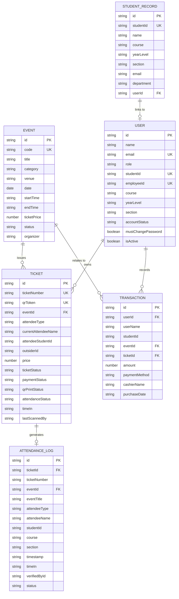

# 📊 Core Data Models & Entity Relationships

> [!INFO] Navigation
> Back to [[00 - Map of Content (Index)]] | Previous: [[01 - System Architecture & Tech Stack]] | Next: [[03 - Role-Based Access Control (RBAC)]]

---

## 1. Entity Relationship Diagram (ERD)



---

## 2. Model Specifications

### 1. `EventItem`
Represents an institutional campus event.
```typescript
interface EventItem {
  id: string;               // e.g. "evt-juans-2026"
  code: string;             // e.g. "NCST-CON-2026"
  title: string;            // e.g. "NCST Foundation Concert"
  description: string;
  category: string;         // 'Academic' | 'Cultural' | 'Sports' | 'Concert'
  venue: string;            // e.g. "NCST Gymnasium"
  date: string;             // YYYY-MM-DD
  startTime: string;        // e.g. "08:00 AM"
  endTime: string;          // e.g. "05:00 PM"
  ticketPrice: number;      // 0.00 for free events
  status: 'upcoming' | 'ongoing' | 'completed' | 'cancelled';
  bannerUrl?: string;
  ticketDesignUrl?: string;
  organizer: string;
}
```

> [!NOTE]
> NCST events do not enforce artificial attendee capacity limits.

---

### 2. `StudentRecord` (Official Institutional Roster)
The authoritative master roster record from the Registrar or Dean's office.
```typescript
interface StudentRecord {
  id: string;               // e.g. "rec-2024-58566"
  studentId: string;        // Official format: YYYY-XXXXX
  name: string;             // Full registered name
  firstName?: string;
  middleName?: string;
  lastName?: string;
  course: string;           // e.g. "BSIT", "BSCS", "BSHM"
  yearLevel: string;        // '1st Year' | '2nd Year' | '3rd Year' | '4th Year'
  section: string;          // NCST format: 11M1, 21M2, 31M1, 41M3
  department: string;       // e.g. "Computer Studies Department"
  email?: string;
  userId?: string;          // Pointer to User login account once registered
}
```

---

### 3. `User`
System login account.
```typescript
type UserRole = 'admin' | 'cashier' | 'teacher' | 'event_staff' | 'student';

interface User {
  id: string;               // e.g. "usr-student-123456"
  name: string;
  email: string;            // Institutional email
  role: UserRole;
  password?: string;
  studentId?: string;       // For students
  employeeId?: string;      // For teachers, cashiers, staff, admins
  course?: string;
  yearLevel?: string;
  section?: string;
  assignedClasses?: TeacherClassAssignment[]; // For teachers
  accountStatus?: 'active' | 'pending_activation' | 'deactivated';
  mustChangePassword?: boolean; // Set to true for auto-created accounts
  isActive?: boolean;
}
```

---

### 4. `Ticket`
Authoritative digital and physical event admission pass.
```typescript
interface Ticket {
  id: string;               // e.g. "tix-10001"
  ticketNumber: string;     // Control number e.g. "TIX-10001"
  qrToken: string;          // Cryptographically unique token
  eventId: string;
  ticketType: 'digital' | 'physical';
  attendeeType: 'STUDENT' | 'OUTSIDER';
  currentAttendeeName: string;
  attendeeStudentId?: string;
  outsiderId?: string;
  price: number;
  ticketStatus: 'ISSUED' | 'USED' | 'VOID' | 'CANCELLED';
  paymentStatus: 'paid' | 'free' | 'refunded';
  qrPrintStatus: 'PENDING' | 'PRINTED' | 'ATTACHED';
  attendanceStatus: 'not_entered' | 'present';
  timeIn?: string;          // Philippine Standard Time string
  lastScannedBy?: string;   // Name of verifying staff
}
```

---

### 5. `AttendanceLog`
Real-time entrance verification log entry.
```typescript
interface AttendanceLog {
  id: string;               // e.g. "log-1728345678"
  ticketId: string;
  ticketNumber: string;
  eventId: string;
  eventTitle: string;
  attendeeType: 'STUDENT' | 'OUTSIDER';
  attendeeName: string;
  studentId?: string;
  course?: string;
  yearLevel?: string;
  section?: string;
  timeIn: string;           // 12-hour PHT string e.g. "08:15 AM"
  timestamp: string;        // ISO 8601 string
  verifiedById: string;     // Staff User ID
  verifiedByName: string;   // Staff Full Name
  status: 'valid' | 'denied';
}
```

---

### 6. `PurchaseTransaction`
Financial audit record generated at the Cashier POS station.
```typescript
interface PurchaseTransaction {
  id: string;               // e.g. "tx-1728345678"
  userId?: string;
  userName: string;
  studentId?: string;
  eventId: string;
  eventTitle: string;
  ticketId: string;
  ticketNumber: string;
  amount: number;
  paymentMethod: 'Cash';    // Strictly cash transactions
  cashierName: string;
  purchaseDate: string;
}
```
