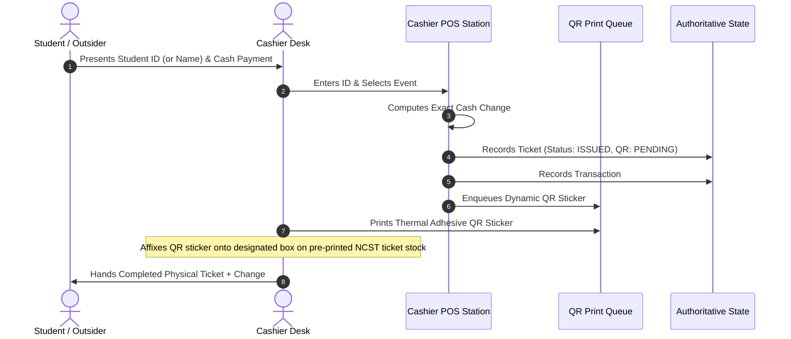

# 🎟️ Cashier POS & Dynamic QR Workflow

> [!INFO] Navigation
> Back to [[00 - Map of Content (Index)]] | Previous: [[03 - Role-Based Access Control (RBAC)]] | Next: [[05 - Student Account & Onboarding Lifecycle]]

---

## 1. Physical Stock + Thermal Dynamic QR Architecture

The NCST ticketing model solves the challenge of pre-printed physical tickets by combining **Pre-Printed Branded Event Ticket Stock** with **Dynamically Printed Thermal Adhesive QR Stickers**.



---

## 2. Step-by-Step POS Process

### Step 1: Attendee Identification & Event Selection
1. **Enrolled Student**:
   - Cashier enters the official Student ID (e.g., `2024-58566`).
   - The POS automatically queries the authoritative student roster (`StudentRecord`) to populate student Name, Course, Year Level, and Section.
   - If the student has never logged in or registered, an account is **automatically provisioned** with default password `ncst123` (see [[05 - Student Account & Onboarding Lifecycle]]).
2. **Outsider / Guest**:
   - Cashier selects the "Outsider" toggle and enters Guest Name, Contact Number, and Affiliation.

### Step 2: Payment & Change Calculation
- Official ticket price is locked to the selected event.
- Cashier enters the amount tendered.
- POS validates:
  $$\text{Tendered Amount} \ge \text{Ticket Price}$$
- Real-time change is calculated:
  $$\text{Change} = \text{Tendered Amount} - \text{Ticket Price}$$

### Step 3: Ticket Creation & Serialization
- The system generates an authoritative Control Number (e.g. `TIX-10009`) and a secure `qrToken`.
- Initial statuses:
  - `ticketStatus`: **`ISSUED`**
  - `paymentStatus`: **`paid`**
  - `qrPrintStatus`: **`PENDING`**
  - `attendanceStatus`: **`not_entered`**

---

## 3. Dynamic QR Print Queue & Thermal Sticker Assembly

```
+-------------------------------------------------------------+
|                     NCST OFFICIAL EVENT TICKET              |
|                                                             |
|  Event: NCST Foundation Concert 2026                        |
|  Date:  October 24, 2026 | 06:00 PM                         |
|  Venue: NCST Gymnasium                                     |
|                                                             |
|  Attendee: Christian Bautista (2026-00129)                  |
|  Section:  BSIT 31M1                                        |
|                                                             |
|  [ PRE-PRINTED ARTWORK & TERMS ]     +-------------------+  |
|                                      | [DYNAMIC THERMAL] |  |
|                                      | [   QR STICKER  ] |  |
|                                      | [   AFFIXED HERE] |  |
|                                      | Control:TIX-10009 |  |
|                                      +-------------------+  |
+-------------------------------------------------------------+
```

1. **Print Queue Module**: [`src/components/cashier/QRPrintQueue.vue`](file:///c:/xampp/htdocs/Integ%202/src/components/cashier/QRPrintQueue.vue)
2. **Thermal Print Layout**:
   - Standard 2" x 1" or 50mm x 30mm thermal label format.
   - Includes high-contrast QR matrix, Ticket Control Number, Event Code, and Attendee Name.
3. **Queue Actions**:
   - **Single Print**: Prints individual sticker and marks status as `PRINTED`.
   - **Batch Print**: Prints all pending queue items in a single print job.
   - **Reprint**: Allows cashier to reprint a damaged or misaligned sticker with logged reprint counts (`qrPrintCount`).
   - **Mark as Attached**: Updates state to `ATTACHED`.

---

## 4. Business Rules & Constraints

> [!IMPORTANT]
> 1. **Cash Only**: All on-campus POS transactions are strictly cash-based.
> 2. **Non-Transferable**: Tickets cannot be transferred between attendees.
> 3. **Paperless Onboarding**: No paper activation slips are required; accounts are immediately active with `ncst123`.
