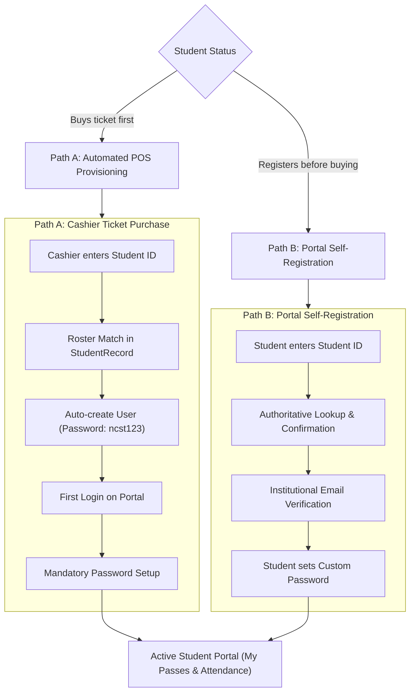
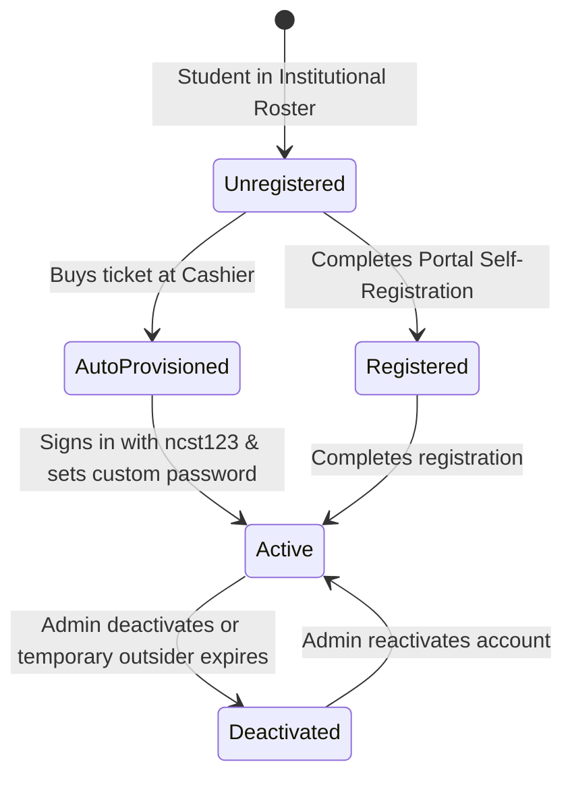

# 🎓 Student Account & Onboarding Lifecycle

> [!INFO] Navigation
> Back to [[00 - Map of Content (Index)]] | Previous: [[04 - Cashier POS & Dynamic QR Workflow]] | Next: [[06 - Entrance Scanner & Attendance Tracking]]

---

## 1. Dual Onboarding Pathways

The system accommodates two distinct paths for enrolled students:

---

## 2. Path A: Automated Account Provisioning (No Activation Slip)

When an enrolled student who does not yet possess a portal login account buys a ticket at the Cashier POS:

1. **Roster Match**:
   - The cashier enters the Student ID (e.g., `2026-00129`).
   - The POS validates the ID against the authoritative institutional roster ([`StudentRecord`](file:///d:/Downloads/INTEG/src/types/index.ts)).
2. **Instant Provisioning**:
   - A `User` record is created automatically without printing paper slips or activation codes:
     - `role`: `'student'`
     - `password`: Hashed verifier of the student's official surname (e.g. `'Hernandez'` or `'De Los Santos'`)
     - `mustChangePassword`: `true`
     - `accountStatus`: `'active'`
3. **First-Time Sign In**:
   - The student visits the portal and signs in with their Student ID and official surname as temporary password.
4. **Mandatory First-Login Password Change**:
   - The portal locks navigation and displays the **First-Time Password Setup Modal**.
   - Backend APIs (`/api/state`, `/api/tickets`) gate access and return empty digital passes and logs until password change is complete.
   - The student must set a permanent secure password (cannot be their surname, `ncst123`, or `password123`).
   - Once updated, `mustChangePassword` is set to `false`.
5. **Instant Pass Visibility**:
   - The purchased ticket immediately appears under **My Passes & Attendance** with full digital QR code.

### ⚠️ Security Limitations of Surname-Based Temporary Passwords
> **Notice on Impersonation Risk**:  
> Using a student's official surname as a temporary password is a **project-specific onboarding convenience**, not a strong security credential. Surnames and student IDs are semi-public directory information known within academic cohorts.  
> - **Impersonation Vulnerability**: An attacker who knows a student's ID number and surname could theoretically log in and set the initial password before the legitimate student does.  
> - **Mitigations Enforced in the System**:
>   1. **Mandatory Change Barrier**: The surname is strictly temporary and must be changed immediately upon first login.
>   2. **Data Gating**: Sensitive student records, attendance logs, and digital ticket barcodes are completely withheld by backend API guards until the permanent password is confirmed.
>   3. **No Password Resets on Repeat Purchases**: Once an account is activated or exists, subsequent cashier ticket purchases **strictly preserve** the student's existing credentials and never reset passwords back to the surname.
>   4. **Password Disallowance**: Students cannot choose their surname, `ncst123`, or `password123` as their permanent password.
>   5. **Auditing**: All password change events are permanently recorded in system audit logs with actor ID, timestamp, and IP address.

---

## 3. Path B: Portal Self-Registration (Authoritative StudentRecord Lookup)

For students who register on the web portal prior to visiting the cashier:

1. **Step 1: Progressive ID Lookup**:
   - Student enters their official Student ID (e.g. `2024-58566`).
   - The portal calls `POST /api/lookup-student`.
   - The backend checks `StudentRecord` and returns the official Name, Department, Course, Year Level, and Section.
   - The UI presents an identity confirmation card:
     > *"We found your student record: Juan Dela Cruz (BSIT — 31M1). Is this you?"*
2. **Step 2: Institutional Email Verification**:
   - A verification OTP is sent to their institutional email (`2024-58566@student.ncst.edu.ph`).
3. **Step 3: Password Configuration**:
   - Student sets their permanent password (minimum 4 characters).
4. **Step 4: Roster Binding**:
   - The account is bound to the `StudentRecord` (`studentRecord.userId = newUser.id`).
   - Any prior tickets purchased under that Student ID are automatically associated with the new account.

---

## 4. Manual Registration Fallback (Roster Exception Handling)

If a newly enrolled transferee or irregular student is not yet indexed in the master CSV roster:
1. The student selects **"Continue with Manual Registration"**.
2. Student provides their Full Name, Course, Year Level, and Section.
3. Account is created with `verificationStatus = 'pending'` and flagged for administrative confirmation.

---

## 5. Account Lifecycle States

