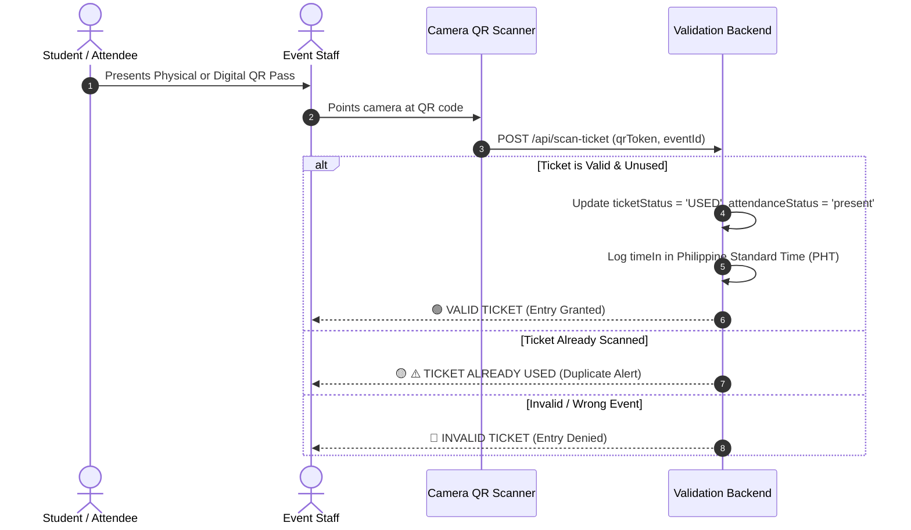

# 📱 Entrance Scanner & Attendance Tracking

> [!INFO] Navigation
> Back to [[00 - Map of Content (Index)]] | Previous: [[05 - Student Account & Onboarding Lifecycle]] | Next: [[07 - Faculty & Teacher Portal]]

---

## 1. Scanner Station Overview

The **Entrance Scanner Station** ([`src/components/staff/StaffDashboard.vue`](file:///c:/xampp/htdocs/Integ%202/src/components/staff/StaffDashboard.vue)) is operated by authorized **Event Staff** at event entrance gates. It supports:
1. **High-Speed Optical Camera QR Scanning**: Continuous real-time video stream scanning via `html5-qrcode`.
2. **OCR / Manual Fallback Entry**: Optical character recognition and alphanumeric Control Number lookup for damaged or unreadable QR codes.
3. **Sound & Visual Feedback**: Distinct auditory cues and color-coded banners for valid entry, duplicate attempts, and invalid tickets.



---

## 2. Validation & Security Checks

Every scan execution undergoes strict sequential validations:

1. **Staff Authorization**:
   - Verifies the user has role `event_staff` or `admin`.
   - Verifies staff is explicitly assigned to this event (`assignedEventIds`).
2. **Ticket Existence**:
   - Matches raw scan against `qrToken`, `ticketNumber`, or `id`.
3. **Event Association**:
   - Confirms the scanned ticket belongs to the active event.
4. **Lifecycle Status**:
   - Rejects tickets marked `CANCELLED`, `REFUNDED`, or `VOID`.
5. **Duplicate Scan Prevention**:
   - If `attendanceStatus === 'present'` or `ticketStatus === 'USED'`, the scan is rejected with the duplicate warning banner displaying previous Time-In and attendee name.

---

## 3. Philippine Standard Time (PHT / UTC+8) Attendance Logging

All entrance timestamps are strictly generated and stored in **Philippine Standard Time (PHT)**:

```typescript
// Time formatting utility
const now = new Date();
const phtTime = now.toLocaleTimeString('en-US', {
  timeZone: 'Asia/Manila',
  hour: '2-digit',
  minute: '2-digit',
  hour12: true
}); // e.g. "08:15 AM"
const isoTimestamp = now.toISOString();
```

### Log Entry Record
When a valid scan occurs, an `AttendanceLog` entry is appended to state and synced to the central database:
* `ticketNumber`: e.g. `TIX-10009`
* `eventTitle`: e.g. `NCST Foundation Concert`
* `attendeeName`: `Christian Bautista`
* `studentId`: `2026-00129`
* `course` & `section`: `BSIT 31M1`
* `timeIn`: `08:15 AM`
* `verifiedByName`: `Staff Maria Santos`
* `status`: `valid`

---

## 4. Hardware Scanner Best Practices

> [!TIP] Scanner Best Practices
> * **Camera Selection**: On multi-camera mobile devices, select the back-facing ultra-wide or macro camera.
> * **Lighting**: Ensure adequate gate lighting; use the integrated flashlight toggle in low-light environments.
> * **Damaged Codes**: If a physical sticker is torn or creased, use the **Manual Ticket Number Entry** box to enter the 8-character Control Number.
