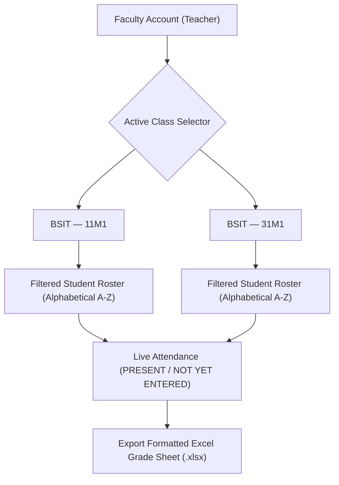

# 👨‍🏫 Faculty & Teacher Portal

> [!INFO] Navigation
> Back to [[00 - Map of Content (Index)]] | Previous: [[06 - Entrance Scanner & Attendance Tracking]] | Next: [[08 - API Endpoints & State Sync]]

---

## 1. Class Scope & Strict Section Isolation

The **Teacher Portal** ([`src/components/teacher/TeacherAssignedAttendanceView.vue`](file:///c:/xampp/htdocs/Integ%202/src/components/teacher/TeacherAssignedAttendanceView.vue)) allows academic instructors to verify event attendance for their assigned course sections without viewing other teachers' students.



---

## 2. Core Portal Features

### 1. Active Class Scope Selector
* Teachers select which assigned section to monitor from an interactive dropdown:
  `[ BSIT — 11M1 ▾ ]` or `[ BSIT — 31M1 ▾ ]`
* Section coding strictly adheres to NCST academic nomenclature:
  $$\text{Section Format: } [\text{Year}][\text{Semester}][\text{Schedule}][\text{Section}] \quad (\text{e.g. } 11\text{M}1, 31\text{M}1)$$

### 2. Alphabetical Roster Sorting (A–Z by Last Name)
To match standard university grade books and class rosters, student entries are automatically ordered by **Last Name** in alphabetical order (A to Z).

### 3. Real-Time Status Indicators
* 🟢 **PRESENT**: Student has been scanned at the entrance gate; displays exact Time-In (e.g., `08:15 AM PHT`).
* ⚪ **NOT YET ENTERED**: Student purchased an official ticket or is enrolled but has not yet passed the entrance scanner.

---

## 3. Scoped Excel Attendance Export

Teachers can export clean, official class attendance sheets for grading and institutional compliance:

```
========================================================================================
NCST CLASS EVENT ATTENDANCE SHEET
Event:      NCST Foundation Concert 2026
Course:     BSIT
Section:    11M1
Teacher:    Prof. Juan Dela Cruz
Generated:  October 24, 2026 09:30 PM (PHT)
========================================================================================
#  | Student ID   | Student Full Name        | Ticket Number | Status  | Time-In (PHT)
---+--------------+--------------------------+---------------+---------+----------------
1  | 2024-58566   | Aquino, Maria Clara      | TIX-10001     | PRESENT | 08:10 AM
2  | 2026-00129   | Bautista, Christian      | TIX-10009     | PRESENT | 08:15 AM
3  | 2024-10022   | Santos, Jose Rizal       | TIX-10004     | NOT IN  | --
========================================================================================
```

---

## 4. Student Roster Import (CSV / Excel)

Faculty advisors and administrators can bulk-import class rosters using the **Student Roster Import View** ([`StudentRosterImportView.vue`](file:///c:/xampp/htdocs/Integ%202/src/components/teacher/StudentRosterImportView.vue)):
* **Accepted Formats**: `.csv`, `.xlsx`, `.xls`
* **Column Mapping**: `Student ID`, `Full Name`, `Course`, `Year Level`, `Section`, `Email`, `Department`.
* **Validation**: Checks for valid NCST student ID format (`YYYY-XXXXX`) and duplicate student records.
